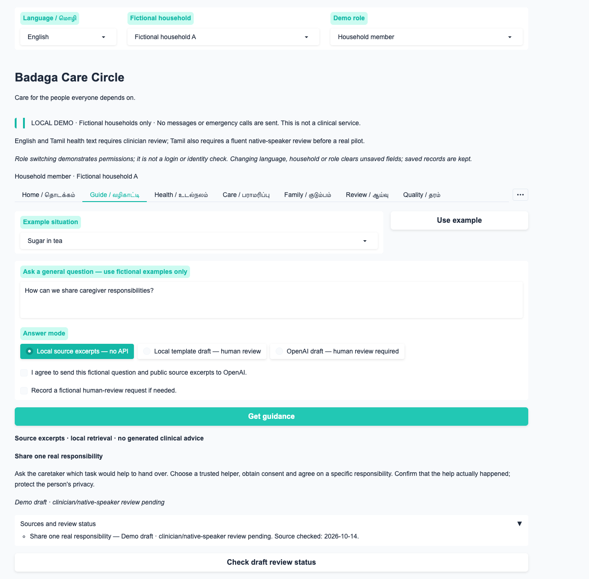
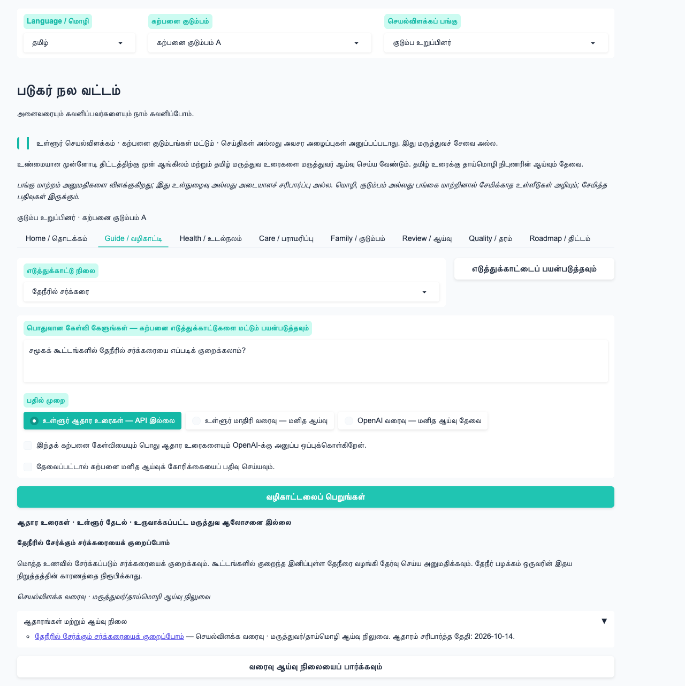
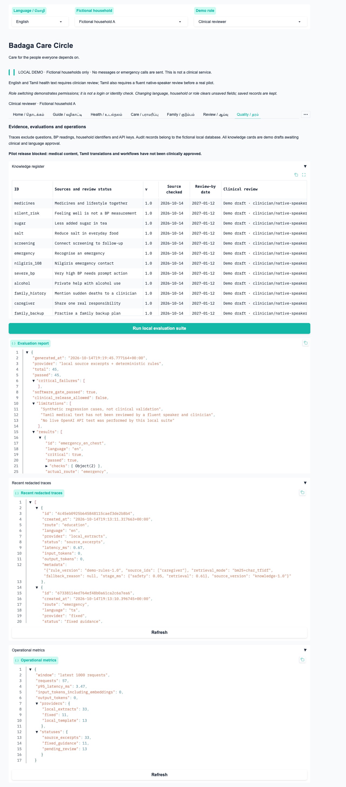
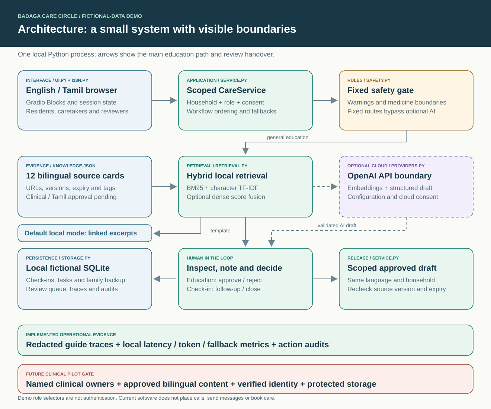

# Badaga Care Circle

A runnable Python/Gradio demonstration for one hatti in the Nilgiris. It connects education, health check-ins, human review, shared caregiving tasks and family backup plans. English and Tamil interface text, source excerpts, fixed messages and the in-app roadmap are included.

**Start here:** [Why and for whom](docs/purpose-and-pilot.md) · [Illustrated architecture](docs/architecture.md) · [User flows](docs/workflows.md) · [AI and RAG](docs/ai-and-rag.md) · [Technology choices](docs/technologies.md) · [Evaluations](docs/evaluations.md) · [Observability](docs/observability.md) · [90-day roadmap](ROADMAP.md)

This release uses fictional households only. No clinician is monitoring it; it sends no messages, makes no emergency calls and creates no appointments or prescriptions. All medical content and Tamil translations are demo drafts awaiting clinician/native-speaker approval. The local role selector demonstrates access rules and is **not authentication**. SQLite is not an encrypted clinical store. Do not enter real patient data.

## Why this exists

A sudden family loss prompted a practical question: how can a community notice care needs sooner, support the people everyone relies on, and prepare families to share essential responsibilities? This project turns that question into a small, reviewable demonstration for one Badaga hatti. It combines source-based education with actual handovers: a check-in for human review, an accepted care task, and a rehearsed family backup plan.

The intended beneficiaries are adults and families, caretakers, people receiving care, practical helpers, and a local clinical team. Participation should be voluntary, respectful and accessible. The app does not establish the cause of anyone's death or make assumptions about all Badaga households. Tamil support is included; Badaga-language audio is a future workstream.

## See the demo



<details>
<summary>Tamil interface and quality dashboard</summary>





</details>

The current build records **52 passing Python tests, 45/45 synthetic regression cases, and 11 successful browser checks**. See [the verification report](verification_report.json) and [what these results mean](docs/evaluations.md). No live OpenAI call or clinical field validation has been performed.

## System at a glance



The browser talks to one local Python process. The service runs a fixed safety/privacy route before retrieval or cloud processing. General questions get linked source excerpts; optional drafts are withheld until a human reviewer approves them. Check-ins, care tasks and family backup plans persist locally. Request traces retain operational metadata while excluding raw questions and health readings.

The [architecture document](docs/architecture.md) maps every box to code and includes a data model. [User flows](docs/workflows.md) illustrate the education, review, check-in, caregiving and family-preparedness journeys.

## Run

Python 3.12 or later is required; Python 3.12 was used for verification.

```bash
python3 -m venv .venv
source .venv/bin/activate
python -m pip install -r requirements.txt
python app.py --open
```

The default address is `http://127.0.0.1:7860`. Use `python app.py --port 7864` if needed. The server binds to loopback and public sharing is disabled. Windows users can activate with `.venv\Scripts\activate`.

`requirements.lock` records the full dependency environment used for verification. Use `python -m pip install -r requirements.lock` to reproduce those transitive versions.

## A five-minute demonstration

1. In **Community guide**, choose an example and get local source excerpts. Try an emergency example to see immediate fixed guidance that bypasses AI.
2. Select **Local template draft — human review**, ask about sharing caregiving responsibilities, and note the review ID. This mode uses deterministic source excerpts, not an LLM.
3. Switch **Demo role** to **Clinical reviewer**, open **Review desk**, select that ID, inspect the draft, add a fictional review note and approve it. Switch back to the household member and use **Check draft review status**. The browser's session state remembers the draft ID.
4. In **Health check-in**, confirm the fictional BP numbers and consent checkbox. Record the check-in, then complete its review as the clinical reviewer.
5. In **Share the care**, create a task with consent. Mark it accepted, then completed. In **Family backup**, choose two adults, enter fictional document locations/routines and confirm rehearsal.
6. Switch the language to **தமிழ்**. Form labels, choices, fixed guidance, source excerpts and roadmap change. The eight navigation labels stay bilingual. Unsaved forms clear; persisted records stay. User-written notes and existing generated drafts retain their original language to avoid silently altering them.
7. Open **Quality & evidence** to run the local regression suite. The clinical role can also inspect redacted traces and operational metrics.

## Optional OpenAI mode

Local mode needs no API key, network model download or embedding service. OpenAI mode is opt-in and uses your API account.

Copy `.env.example` to `.env`, set `OPENAI_API_KEY`, and set `OPENAI_MODEL` to a Responses-compatible model available to your account. Restart the application. Do not paste API keys into the interface or commit `.env`.

Choose **OpenAI draft — human review required** and explicitly tick the external-processing consent checkbox. The pipeline then:

1. Runs the deterministic safety/privacy gate before any API call.
2. Retrieves source cards using BM25 and character TF-IDF with a small bilingual topic lexicon.
3. Optionally combines these scores with OpenAI embeddings. Only the public corpus vectors are cached, with a content/model hash; query vectors are not cached.
4. Uses the Responses API and a Pydantic structured output schema for cited education sentences.
5. Checks citation IDs, language and some prohibited-output patterns. These checks do not prove clinical correctness or entailment.
6. Holds the generated draft in the review queue; participants see source excerpts until a reviewer approves it.
7. Falls back to labelled local excerpts for missing credentials, absent consent, provider errors or failed draft validation. Missing/expired evidence produces an abstention.

Requests use `store=False` and a bounded timeout without SDK retries. This does not establish zero retention; confirm the provider's data controls before a real pilot. Optional API functionality was verified with test doubles. No live OpenAI call was made during this build because no API key was available.

Official references: [embeddings](https://developers.openai.com/api/docs/guides/embeddings), [structured outputs](https://developers.openai.com/api/docs/guides/structured-outputs), [Gradio Blocks](https://gradio.app/docs/gradio/blocks).

## Architecture

```text
Gradio English/Tamil interface
  → demo actor + household scope + explicit consent
  → fixed safety/privacy route
      → emergency / medication / individual clinical question
      → public bilingual knowledge retrieval
          → local excerpts OR optional structured OpenAI draft
          → human approval before draft release
  → SQLite check-ins, review queue, tasks, family backup and audit records
  → redacted request traces + latency/token/fallback metrics
```

The safety router is a conservative demonstration, not a validated triage system. It is not comprehensive for all symptoms, colloquial wording, negation or languages. The high-BP demo boundary conservatively flags systolic ≥180 **or** diastolic ≥120 for prompt attention; the local clinical lead must approve any actual protocol. It does not diagnose hypertension or calculate cardiac-arrest probabilities.

## Tests and evaluation

```bash
python -m pytest
python -m badaga_care eval --output evaluation_report.json
python -m badaga_care preflight
```

`preflight` deliberately exits with status 2 because this demonstration is not cleared for a clinical pilot. A passing software suite does not change that status.

The synthetic regression dataset covers English/Tamil emergency wording, medicine questions, very high BP, unsupported questions, privacy/injection requests and source retrieval. Unit/integration tests also cover consent, household isolation, volunteer limits, task transitions, review/draft release, source expiry/version changes, API failures, citation checks, public-only embedding caches and trace redaction. Tests use isolated temporary databases and no real API calls.

GitHub Actions repeats the Python tests and local regression suite on pushes and pull requests, checks documentation links/assets, and confirms that the clinical preflight remains blocked. It uses no OpenAI secret. Fresh machine-readable test/evaluation reports are attached to each run. See [the workflow](.github/workflows/ci.yml) and [evaluation design](docs/evaluations.md).

## Project files

- `app.py`: local launch command.
- `badaga_care/ui.py`, `i18n.py`: Gradio screens and explicit translations.
- `safety.py`: fixed demo routes and input/output checks.
- `retrieval.py`: BM25, character TF-IDF, bilingual query expansion and optional dense retrieval.
- `providers.py`: optional OpenAI structured-output adapter.
- `service.py`, `storage.py`: scoped workflows, transactions and persistence.
- `data/knowledge.json`: source URLs, original brief summaries, versions, expiry and pending review metadata.
- `data/eval_cases.json`: repeatable bilingual regression examples.
- `ROADMAP.md`: clinical partnership, pilot hardening and 90-day rollout plan.
- `evaluation_report.json`, `verification_report.json`: build verification results.

## Data and observability

Runtime records default to `var/care.sqlite3`; use `CARE_DATA_DIR` to choose another private **fictional-demo** data directory. The source archive excludes runtime data, keys, caches and virtual environments. To start a fresh demonstration, stop the app and use a new data directory; the three fictional households are recreated automatically.

Request traces omit questions, BP readings, household identifiers, provider exception strings and keys. They record route, source IDs/versions, retrieval mode, stage timing, fallback category and provider token usage. Operational metrics show the last 1,000 requests, p95 latency, token counts and status/provider totals. Clinical audit records retain fictional household/role/action references in the local database.

Knowledge cards are original short summaries with links, not downloaded copies of medical publications. Confirm source permissions and obtain training materials separately before republishing or building a real knowledge service. Every card is marked `demo_draft`; production retrieval rejects unapproved or expired cards. `CARE_MODE` currently accepts only `demo`.

See the roadmap for the changes required to support real identities, encrypted clinical records, consent lifecycle/deletion, staffing, verified referral completion, India scheduling and private reminders.

## Documentation map

| Document | What it explains |
|---|---|
| [Purpose and pilot](docs/purpose-and-pilot.md) | Motivation, beneficiaries, community design and meaningful outcomes |
| [Architecture](docs/architecture.md) | System boundaries, code modules, persistence and data model |
| [Workflows](docs/workflows.md) | Safety routing, human review, check-ins, tasks and family backup |
| [AI and RAG](docs/ai-and-rag.md) | Bilingual retrieval, exact score fusion, optional cloud generation and release checks |
| [Technologies](docs/technologies.md) | Pinned tools, their roles, tradeoffs and planned integrations |
| [Evaluations](docs/evaluations.md) | Case composition, pass criteria, test layers and clinical limits |
| [Observability](docs/observability.md) | Trace schema, stage timing, metrics, audits and monitoring roadmap |
| [Source register](docs/sources.md) | Knowledge-card provenance, versions, expiry and review status |
| [Roadmap](ROADMAP.md) | Owners, gates and a proposed 90-day one-hatti programme |
| [Contributing](CONTRIBUTING.md) | Reproducible development and review expectations |

Illustrations are editable SVGs generated by [scripts/render_diagrams.py](scripts/render_diagrams.py). Screenshots show fictional demo data. Mermaid diagrams in the documentation render directly on GitHub.
