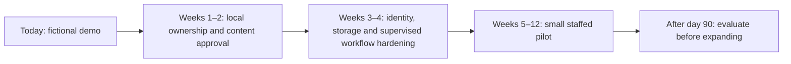

# One-hatti implementation roadmap

**Objective:** increase completed screening/follow-up, give caretakers practical help, and make essential family responsibilities transferable. The programme should include adults of all genders and abilities. Local observations about diet, alcohol and pressure are hypotheses to explore respectfully, not claims about every Badaga family or about the cause of an individual's death.

[Purpose and beneficiaries](docs/purpose-and-pilot.md) · [Architecture](docs/architecture.md) · [Evaluations](docs/evaluations.md) · [Observability](docs/observability.md)

## Current release — implemented

| Area | Working capability |
|---|---|
| Interface | Gradio with English/Tamil switching, three fictional households and role demonstrations |
| Knowledge | Twelve bilingual source cards with URLs, versions, review dates, expiry and explicit draft status |
| Retrieval | Local BM25 + character TF-IDF + bilingual topic expansion; optional OpenAI dense embeddings |
| AI | Optional Responses API/Pydantic education drafts; consent gate, citation checks, withheld output, API fallback |
| Human review | Persistent review queue, notes, approval/rejection, household-scoped draft release, source-version invalidation |
| Clinical demonstration | Fixed warning routes, measurement/unit confirmation, consent and atomic check-in/review creation |
| Caregiving | Consent-based local task records and requested → accepted → completed transitions |
| Family continuity | Two backup adults, private fictional routines/document locations and rehearsal confirmation |
| Observability | Redacted request traces, stage timing, provider/token/fallback metrics and local action audits |
| Evaluation | Bilingual synthetic regression cases and workflow/provider tests; a clinical preflight that remains blocked |

No clinical service, appointment booking, messaging integration or real identity system is deployed. Optional OpenAI network requests require your credentials and explicit demo consent. The software does not establish clinical accuracy or validate the Tamil translations.

## Weeks 1–2 — build local ownership

**People:** one named clinical lead; a nurse or other appropriately qualified coordinator; two community coordinators; a fluent Tamil reviewer; a small resident advisory group including caregivers and people who need care.

**Work:**

- Choose the hatti and listen to a small, varied group of households about access, language, privacy, caregiving and existing support.
- Confirm a local screening/referral arrangement and an actual receiving clinical team. Agree on review hours, case ownership, backup staffing and response times by urgency.
- Review the entire medical corpus, fixed warning messages, BP workflow and English/Tamil wording. Test colloquial expressions, number confirmation and the distinction between general education and symptoms occurring now.
- Reconfirm emergency numbers, local referral destinations and available CPR training. Emergency action must never depend on a chat, source search or asynchronous reviewer.
- Check content permissions and source provenance. Record named approval, version and review-by date for each clinical/language asset.
- Agree on voluntary enrolment, who can see which fields, what can be shared with helpers, and how withdrawal/deletion works.

**Gate:** named clinical ownership, approved bilingual content and pathways, staffed referral capacity, and resident acceptance. A software test score alone cannot clear this gate.

## Weeks 3–4 — harden for a supervised pilot

**Engineering:**

- Replace the role/household pickers with verified identities. Enforce household membership and clinical permissions on the server, independent of UI visibility.
- Move fictional SQLite workflows to an appropriately protected clinical-data service. Add encrypted storage/backups, secret management, access auditing, retention and deletion controls.
- Record consent purpose/version/time and withdrawal. Keep health sharing separate from household task sharing; volunteers should see only the practical information required for their assignments.
- Schedule pilot events in `Asia/Kolkata`; retain UTC storage and display the intended local timezone clearly.
- Add clinician-assigned due dates, overdue escalation to a staffed backup, concurrent-update handling and evidence of actual referral completion.
- Introduce a knowledge publication process: draft → clinical/language review → approved version → expiry/review. Revalidate already approved drafts when source content changes.
- Review cloud-provider data handling, minimal-context payloads, access, retention and model availability. Set spending/concurrency limits. Keep raw clinical content out of external operational traces.
- Build incident reporting, error/fallback monitoring, restore drills and rollback of prompts/models/sources.

**Evaluation:**

- Extend the synthetic dataset with clinician-written cases and resident wording; keep a held-out test set.
- Test emergency routing, medication boundaries, ambiguous inputs, Tamil grammar/meaning, accessibility, household isolation and API outages.
- Grade generated drafts for factual support, missing context, citation entailment, readability and human-review workload. Citation-ID membership is only one check.
- Complete bilingual usability sessions and practical CPR/AED instruction through qualified trainers.

**Gate:** approved content/pathways, verified access, recoverable storage, documented consent, staffed reviews, acceptable bilingual usability, and no unresolved critical software failures in the agreed test set. Publish known limitations.

## Weeks 5–12 — 30–50 consenting households

The size is a planning proposal; reduce it if clinical staffing or referral access cannot support timely follow-up.

**Programme work:**

- Arrange baseline screening through the clinical partner and record a clinician-defined follow-up plan.
- Review overdue referrals and delivery failures on a staffed schedule. Confirm completed care, rather than counting sent reminders.
- Ask each willing caretaker what help would matter. Agree on one specific handover and check whether it happened.
- Offer respectful community changes such as less-sweet tea choices and voluntary activity groups, with appropriate individual clinical advice.
- Let families choose two trusted backup adults and rehearse essential routines. Keep credentials outside the service.
- Introduce private reminders only after opt-in, receiving-team agreement and delivery/failure testing. No medical details in community group messages.
- Review concerns and incidents weekly with the clinical team and resident representatives. Pause a problematic workflow while maintaining access to human care.

**Measures:**

| Measure | Definition |
|---|---|
| Screening coverage | Eligible enrolled adults with completed screening / eligible enrolled adults |
| Follow-up completion | Referrals completed by the clinician-assigned due date / referrals due |
| BP follow-up | Repeat readings and control assessed using the clinician's agreed protocol |
| Practical caregiver help | Accepted tasks actually completed and confirmed by the person receiving help |
| Family preparedness | Willing households with two backup adults who can perform the agreed routines |
| Reliability | Missed reviews, delivery failures, delays, fallbacks, privacy incidents and staff workload |
| Participation | Dropout, accessibility difficulties, reasons for non-participation and requests to withdraw |

Use a baseline and consistent denominators. Avoid public household rankings, health/stress leaderboards or tiny identifiable community statistics. A small 90-day pilot cannot establish reduced cardiac-arrest or sudden-death rates.

## After day 90 — decide whether to expand

Review the outcomes, missed care, incidents, resident trust, costs and clinical workload. Expand to another hatti only when the receiving clinical team and community coordinators can support it. Reapprove changed content, prompts and models; retain versioned evaluation results. Obtain qualified advice before adding functions that change the product's clinical, privacy or financial responsibilities.

## Prioritised backlog

| Priority | Item | Owner |
|---|---|---|
| P0 | Clinical/Tamil approval and staffed referral agreement | Clinical lead + language reviewer + coordinators |
| P0 | Verified identities and enforced household/clinical permissions | Engineering |
| P0 | Protected clinical storage, consent lifecycle and incident handling | Engineering + programme lead |
| P0 | Validated urgent pathways and practical emergency training | Clinical lead + trainers |
| P1 | Referral due dates, confirmed completion and reliable private reminders | Clinical coordinator + engineering |
| P1 | Bilingual accessibility, reviewed recorded audio and field evaluation | Residents + language reviewer + engineering |
| P1 | Source publication/versioning, draft quality grading and restore drills | Clinical reviewer + engineering |
| P2 | Integrations with an agreed clinic system and sustainable community funding | Clinical partner + programme lead |

Badaga-language audio is a later, separately reviewed workstream. Tamil support should not be represented as Badaga-language support.
