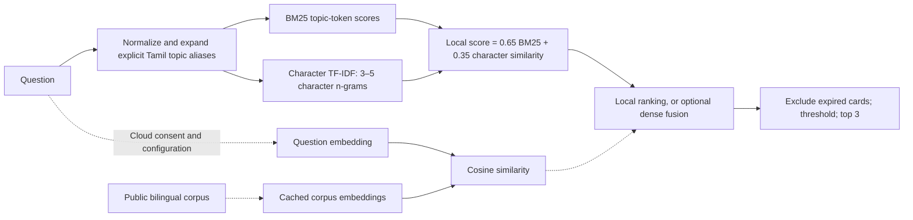

# AI, bilingual RAG and human review

[Home](../README.md) · [Architecture](architecture.md) · [Flows](workflows.md) · [Evals](evaluations.md)

RAG means retrieving relevant evidence before drafting a response. This demo makes the evidence visible and treats generated text as a draft requiring human review. Local mode returns existing source summaries and does not generate text with a language model.

## Corpus and ingestion

[`data/knowledge.json`](../data/knowledge.json) is a curated set of twelve original, brief bilingual summaries. Each card has an ID, English/Tamil title and text, tags, source URL/name, version, checked date, expiry, pending approval fields and reuse notes. The app loads this file at process startup; it does not crawl the web, ingest clinical files, or automatically approve new information. See the [source register](sources.md).

Retrieval uses both languages together in each public corpus entry. Expiry filtering happens before results are returned. A changed file needs a service restart to load into the running retriever. Demo cards remain visibly unapproved. Future clinical and language publication approval is a separate process from reviewing an individual draft.

## Exact retrieval design



BM25 is implemented directly with length normalization (`k1=1.5`, `b=0.75`) and normalized by the largest score for the current query. Character vectors use scikit-learn `TfidfVectorizer(analyzer="char_wb", ngram_range=(3,5))`. Explicit Tamil aliases connect common topic roots/suffixes to English tags. They are a small hand-written lexicon, not translation or comprehensive language understanding.

In optional dense mode, the final score is `0.55 × local_score + 0.45 × max(cosine_similarity, 0)`. Cards must score at least `0.15`. A card without any BM25 topic match also needs dense similarity of at least `0.4`; character overlap alone is insufficient. At most three cards are returned. These heuristic weights and thresholds are demo choices, not clinically calibrated confidence probabilities.

Public corpus embedding caches are keyed by the embedding model and a SHA-256 corpus hash. Query embeddings are not cached. Cache generation is locked within a process. There is no vector database: NumPy handles the small dense matrix in memory. The default optional embedding model is `text-embedding-3-small`. [OpenAI embeddings documentation](https://developers.openai.com/api/docs/guides/embeddings).

## Three answer modes

| Mode | Output seen immediately | Draft handling | Network |
|---|---|---|---|
| Local excerpts | Linked original source summaries | No generated draft | None |
| Local template draft | Source summaries plus pending status | Deterministic stand-in, queued for approval | None |
| Optional OpenAI draft | Source summaries plus pending status when successful | Structured generated draft, queued for approval | Embeddings and Responses API, after consent |

Missing consent/configuration and provider or validation failures produce labelled local fallbacks. No active evidence produces an abstention. The fixed safety gate always runs before optional external calls; fixed routes bypass retrieval/generation.

## Structured generation

The optional provider uses `client.responses.parse()` with a Pydantic `EducationDraft`. The schema allows one to five sentences, each with text and supporting source IDs, plus a short next step. It limits sentence/field length. The prompt asks for general education using only supplied evidence, in the selected language, and prohibits diagnosis, medication changes, risk prediction and cause-of-death claims. Source/user text is identified as data.

```json
{
  "sentences": [
    {"text": "A brief educational statement.", "source_ids": ["caregiver"]}
  ],
  "next_step": "Discuss one practical handover with the family."
}
```

This illustrates the shape, not a live model result. Citation-ID membership, required language characters and prohibited-output patterns are checked. They do **not** verify that each source entails the sentence, assess translation quality, or prove clinical correctness. A human must inspect the actual draft and evidence. [OpenAI structured outputs documentation](https://developers.openai.com/api/docs/guides/structured-outputs).

The adapter uses a 20-second SDK timeout, no SDK retries, a 1,200-output-token limit and `store=False`. The timeout is per provider operation, not a guaranteed end-to-end request deadline. `store=False` alone does not establish zero retention. The model must be configured to a Responses-compatible model available to the operator's account. There is no configured automatic model selection, budget enforcer or autonomous clinical agent.

## Review and release

Every generated/template education draft is persisted as pending with its language, source IDs and card versions. Participants initially see linked excerpts. A demo clinical reviewer inspects it, enters required notes and approves or rejects. Approval checks source versions and expiry; release repeats the checks and enforces household scope and language. A stale or unapproved draft stays unavailable as an approved answer.

The current notes filter rejects some secret patterns and prescription-like instructions. Reviewer qualifications, actual staffing, review time limits and an approved bilingual corpus remain required for a real pilot. Editing a model, prompt, source or router should trigger the regression and human-review process described in [evaluations](evaluations.md).

## Current verification boundary

The provider is tested with fake clients and the real OpenAI SDK using an in-memory HTTP transport. Those tests check request shape, schema parsing, withholding, failures and usage accounting. No real OpenAI request was made during the build. Live-model quality, citation entailment, cost, latency and Tamil fluency remain unmeasured.
