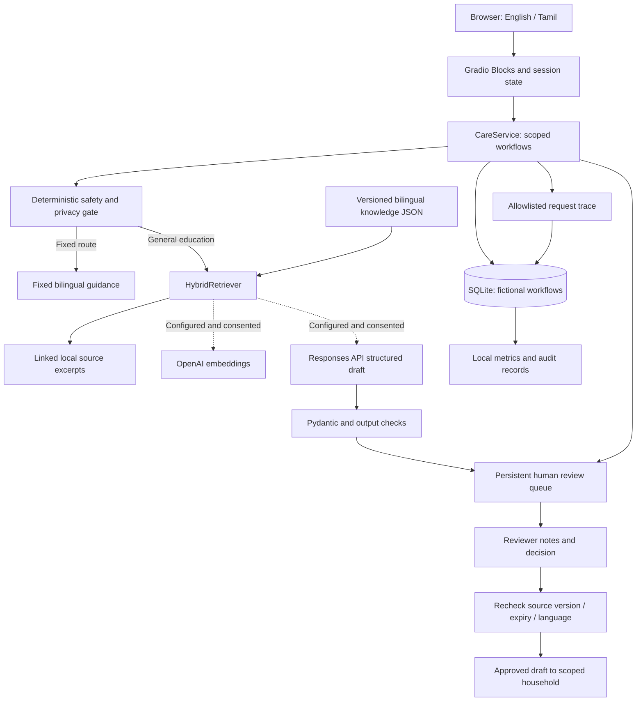
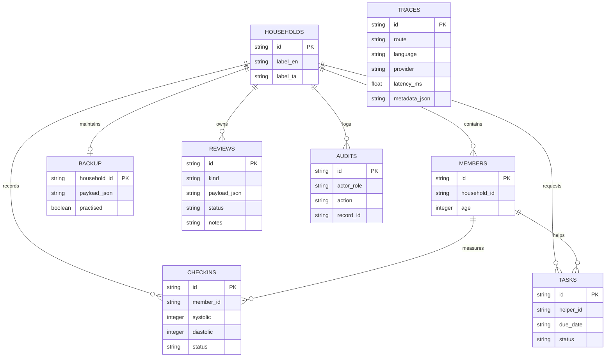
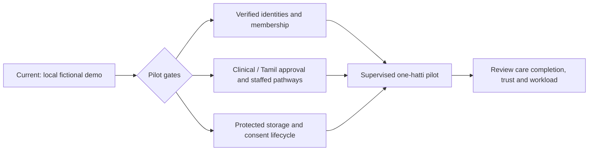

# Illustrated technical architecture

[Home](../README.md) · [Flows](workflows.md) · [RAG](ai-and-rag.md) · [Technologies](technologies.md) · [Observability](observability.md)

Solid connections describe the current demonstration. The dashed cloud boundary is optional and consent-gated. The bottom pilot gate describes required future work. All components run in one Python process except the browser and optional OpenAI service; the boxes are responsibilities, not deployed microservices.

## Component map

| Responsibility | Implementation | Why it exists |
|---|---|---|
| Local launch | [`app.py`](../app.py) | Loopback binding, chosen port, no public Gradio sharing |
| Interface and state | [`ui.py`](../badaga_care/ui.py), [`i18n.py`](../badaga_care/i18n.py) | Explicit translations, stable eight-tab navigation, context-specific components |
| Workflow coordination | [`service.py`](../badaga_care/service.py) | Applies scope, consent, safety, retrieval, review and persistence in a defined order |
| Fixed boundaries | [`safety.py`](../badaga_care/safety.py) | Routes warning, medication, individual clinical and privacy requests before optional AI |
| Evidence retrieval | [`retrieval.py`](../badaga_care/retrieval.py) | Bilingual lexical/character retrieval with optional dense score fusion |
| Structured draft adapter | [`providers.py`](../badaga_care/providers.py), [`models.py`](../badaga_care/models.py) | Constrains draft shape and citation IDs; does not certify clinical correctness |
| Local store | [`storage.py`](../badaga_care/storage.py) | Scoped queries, transactions, task states, review records, traces and audits |
| Configuration | [`config.py`](../badaga_care/config.py), [`.env.example`](../.env.example) | Demo-only mode, private data location, timezone and optional provider settings |
| Evaluation | [`evals.py`](../badaga_care/evals.py), [`tests/`](../tests/) | Reproducible software regression checks using fictional cases |

## Runtime and trust boundaries

The default server listens on `127.0.0.1`. A user's browser calls the local Gradio event handlers, which construct a demo `Actor(role, household_id)` and call `CareService`. The store checks the requested household and role before returning scoped records. This exercises access rules but is not identity verification: anyone using the role picker can choose the clinical role.

Local education does not need an API key or model download. In optional OpenAI mode, the gate runs first. Consent and configuration are required before a question can leave the process. The embedding endpoint receives public corpus text and the current question; the draft endpoint receives the question, selected source text, language instruction and schema. It does not receive the household database or backup checklist. Secret-pattern filtering is limited and does not make a user-entered question anonymous.

Private workflow records and operational traces share the same demo SQLite file. The trace fields are minimized, but this is not physical separation, encryption or production privacy infrastructure. A real deployment needs protected storage, verified identities and a consent lifecycle.

## Persistence and data model

These are logical relationships enforced by service/store checks, not declared SQLite foreign-key constraints. `traces` intentionally has no household key. JSON review payloads contain the draft and source versions, or fictional check-in references. The default database is `var/care.sqlite3`; `CARE_DATA_DIR` can point to a different fictional-demo directory.

SQLite uses WAL mode and short-lived connections with commit/rollback. A confirmed check-in, its review and its creation audit are inserted in one transaction. Clinical review completion updates both the review and associated check-in together. Other workflow actions write their audit in a separate transaction; the audit is not a tamper-proof event ledger. The main database file uses owner-only permissions; this is not encryption or a complete backup/security policy.

## Version and freshness handling

Knowledge cards have stable IDs, versions, source URLs, checked dates, expiry and clinical/language review fields. Expired cards are excluded. Demo retrieval allows unapproved cards and visibly labels them as drafts. A `production=True` retrieval filter requires named approvals, but the application supports only `CARE_MODE=demo`; that filter is not a production launch option.

Education review payloads snapshot each selected card's version. Approval and release check current version and expiry; stale drafts are not released. The provider prompt has a constant version in code. Current traces record rule version and an aggregate knowledge version label, not the prompt/model version or every individual card version. The [observability roadmap](observability.md) describes those missing provenance fields.

## Deployment progression

The repository does not deploy a hosted health service, message residents, create appointments or place emergency calls. The [roadmap](../ROADMAP.md) specifies owners and decisions required before a supervised pilot.
