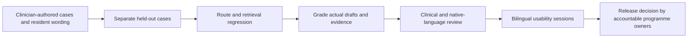

# How evaluations are done

[Home](../README.md) · [AI and RAG](ai-and-rag.md) · [Observability](observability.md) · [Roadmap](../ROADMAP.md)


The current build passed **52 Python tests, 45 synthetic cases and 11 browser checks**. These are software regression results, not evidence of clinical efficacy, comprehensive triage coverage or fluent Tamil medical wording. [Evaluation report](../evaluation_report.json) · [Build verification report](../verification_report.json).

## Layer 1: repeatable bilingual route and retrieval cases

[`data/eval_cases.json`](../data/eval_cases.json) contains **45 synthetic cases: 29 English and 16 Tamil**, including **29 marked critical**. The harness runs the same local source-excerpt mode against a fresh temporary database. No model provider is called.

| Expected route | Cases | Main behavior checked |
|---|---:|---|
| `emergency` | 9 | Current warning wording gets fixed guidance, including a required action string |
| `clinical_review` | 10 | Medication changes, individual diagnosis/prediction and out-of-scope clinical questions get a boundary |
| `urgent_review` | 4 | Very-high-BP wording and boundary numbers get prompt-attention guidance |
| `blocked` | 4 | Selected secrets and instruction-injection patterns are blocked |
| `education` | 16 | General topics retrieve the expected source or fixed source reference |
| `abstain` | 2 | Unsupported questions do not invent evidence |

For every case, the harness checks the expected route. A case may also require a source ID and/or an exact action substring. Tamil cases check that at least one Tamil Unicode character appears. A case passes only if all its checks pass. `software_gate_passed` requires every case to pass and no critical failures. `clinical_release_allowed` remains `false` regardless of the score.

The Unicode check does not grade grammar or meaning. Expected-source membership does not measure ranking quality, completeness or citation entailment. The cases are authored to exercise known rules; the dataset is small and is not a representative or held-out clinical test set.

```bash
python -m badaga_care eval --output evaluation_report.json
```

The report includes UTC generation time, case IDs/languages, pass checks, actual routes, source IDs, request latency, critical failures and explicit limitations. A regression failure returns exit code 1.

## Layer 2: workflow, access and provider tests

```bash
python -m pytest
```

| Area | Evidence exercised | Test source |
|---|---|---|
| Record consent and confirmation | Check-in is not persisted without the required checks; emergency guidance appears before saving | [`test_workflows.py`](../tests/test_workflows.py) |
| Demo household scope | Cross-household reads/writes fail; volunteers cannot inspect check-ins, private backup or reviewer operations | [`test_workflows.py`](../tests/test_workflows.py) |
| Persistent workflows | Atomic check-in/review creation, task transitions, two-person backup, reviewer notes and education release | [`test_workflows.py`](../tests/test_workflows.py) |
| Evidence freshness | Expired cards are excluded; changed/expired source versions prevent approval or release | [`test_workflows.py`](../tests/test_workflows.py) |
| Optional cloud boundaries | No calls before consent; API/config failures fall back; invalid citations fail validation; drafts are withheld | [`test_ai_adapter.py`](../tests/test_ai_adapter.py) |
| Cache and telemetry | Public-only model/content-hashed embeddings, token accounting and trace exclusion of request/exception content | [`test_ai_adapter.py`](../tests/test_ai_adapter.py) |
| Actual SDK contract | Responses structured parsing and embedding requests through in-memory HTTP transport | [`test_sdk_contract.py`](../tests/test_sdk_contract.py) |

These tests use temporary fictional stores and deterministic doubles. The SDK contract tests instantiate the installed SDK rather than calling an external service. They verify protocol behavior, not real model reliability or cost.

## Layer 3: browser verification

The included build report records eleven end-to-end browser checks: English RAG, template creation, human approval and household release, consented check-in, task transitions, backup rehearsal, Tamil interface/RAG, Tamil emergency bypass, Tamil roadmap, 390-pixel mobile layout, and the quality screen's evals/traces/metrics. The report records zero browser errors and a 390-pixel content width at that viewport. Screenshots show fictional data.

This was build-time verification using Playwright and Chromium against the local app. It is not part of the current GitHub Actions job and the report is not a guarantee that every browser, device, assistive technology or future change is covered. Recheck the five-minute demo in the [README](../README.md) after interface changes, with both languages and a narrow viewport.

## CI and reproducibility

The [GitHub workflow](../.github/workflows/ci.yml) checks out source, installs the pinned Python 3.12 dependency environment, runs pytest and the offline eval, validates local documentation links and SVG assets, and checks that `preflight` still exits 2 with clinical release blocked. It uploads only synthetic evaluation and JUnit/preflight reports, including on failures where reports are available. No OpenAI key is supplied and no runtime database is uploaded.

CI repeats software checks; it does not deploy the app or mark it clinically approved. Committed build reports are snapshots. The run artifacts contain the fresh results for that commit.

## Human evaluation before a pilot



For generated drafts, reviewers should grade factual support sentence by sentence, citation entailment, omitted context, unsafe reassurance, medication boundaries, Tamil meaning, readability, non-medical next step and review effort. Record model, prompt, corpus and rubric versions. Evaluate ambiguous and colloquial symptoms, negation, Tamil digits, mixed scripts, adversarial inputs, absent/expired evidence and cloud outages. Keep a held-out set and investigate every critical failure rather than reporting only an average score.

No live-model evaluation, clinician adjudication, native Tamil sign-off, field usability study or outcome study has happened in this build. A pilot needs those activities plus identity, protected storage, consent and staffed referral arrangements. The [preflight command](../badaga_care/__main__.py) deliberately remains blocked.

## Operational evaluation after supervised enrolment

Use the roadmap's denominators for screening and referral completion. Check review delays, failed handovers, real helper acceptance, staff workload, dropouts and access difficulties. Clinical outcomes and operational reliability need separate assessment. Token usage and chatbot engagement do not show that a family received care.
