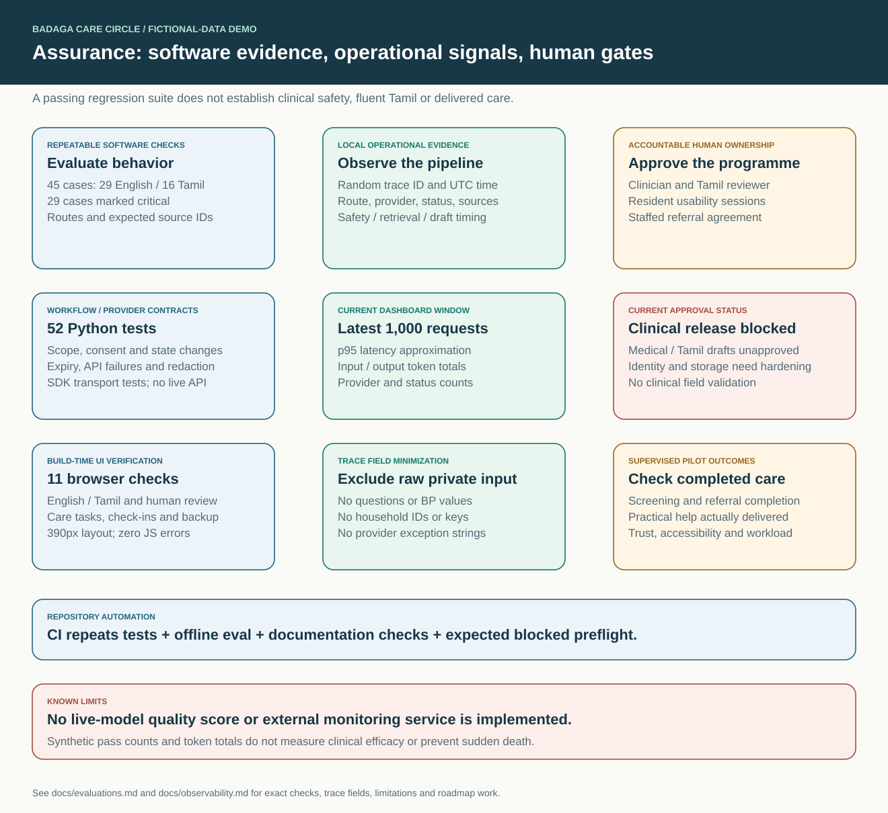
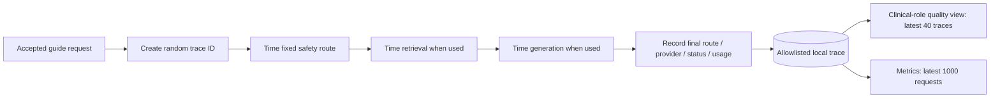

# How observability works

[Home](../README.md) · [Architecture](architecture.md) · [Evaluations](evaluations.md) · [Roadmap](../ROADMAP.md)



Observability currently means **local structured request traces, operational aggregates and action audits** in SQLite. It is implemented in [`CareService.ask`](../badaga_care/service.py) and [`Store.trace`, `Store.metrics`, `Store.audit`](../badaga_care/storage.py). There is no external trace exporter, monitoring dashboard service or automatic alert dispatcher in this release.

## Request lifecycle



The service uses `perf_counter()` for stage and total elapsed time. Fixed routes have a safety stage and `retrieval_mode=bypassed`. General requests add retrieval timing; attempted draft generation adds generation timing. Embedding time is part of retrieval. The timers are dictionary fields, not distributed OpenTelemetry spans.

Tracing covers guide requests that reach successful finalization. Validation failures before trace creation, some unexpected internal failures, and non-guide workflows do not get the same request trace. Task/check-in/backup/reviewer actions instead have audit entries. A production system needs fuller success/failure instrumentation with the same privacy discipline.

## Trace schema

| Field | What is recorded |
|---|---|
| `id`, `created_at` | Random request identifier and UTC time |
| `route`, `language` | Demonstration route and `en` / `ta` |
| `provider`, `status` | Fixed/local/template/OpenAI path and final state |
| `latency_ms` | Request duration before trace persistence |
| `input_tokens`, `output_tokens` | Reported usage; input includes embeddings when usage is returned |
| `metadata.rule_version` | Safety-rule version |
| `metadata.source_ids` | Public source-card identifiers |
| `metadata.retrieval_mode` | Bypassed, local hybrid, or hybrid plus optional embeddings |
| `metadata.fallback_reason` | A limited category such as consent needed or provider unavailable |
| `metadata.stage_ms` | Safety, retrieval and generation timings when used |
| `metadata.source_version` | Current aggregate label `knowledge-1.0` |

The metadata writer keeps only these allowed keys. Current call sites pass controlled metadata. They do not pass raw questions, BP readings, household/member IDs, backup text, keys or provider exception strings. Exceptions are caught without logging their text because request/credential data can appear in them. This is tested with injected values in the provider tests.

Illustrative record; values below are fabricated, not a measured benchmark:

```json
{
  "id": "example-random-trace-id",
  "route": "education",
  "language": "ta",
  "provider": "local_extracts",
  "status": "source_excerpts",
  "latency_ms": 4.2,
  "input_tokens": 0,
  "output_tokens": 0,
  "metadata": {
    "rule_version": "see RULE_VERSION in safety.py",
    "source_ids": ["caregiver"],
    "retrieval_mode": "bm25+char_tfidf",
    "fallback_reason": null,
    "stage_ms": {"safety": 0.2, "retrieval": 3.7},
    "source_version": "knowledge-1.0"
  }
}
```

## Metrics you can inspect today

Select the demo clinical role and open **Quality / தரம்**. The trace table shows the latest 40 requests. The metrics summarize the latest 1,000 stored guide requests, not a fixed time period or all lifetime activity.

| Metric | Actual calculation / interpretation |
|---|---|
| Requests | Number of rows in the current window |
| p95 latency | Sorted latency at zero-based index `min(n-1, int(n*0.95))`; a simple demo approximation |
| Input tokens including embeddings | Sum of recorded input usage |
| Output tokens | Sum of recorded draft output usage |
| Provider counts | Count grouped by final provider label |
| Status counts | Count grouped by final status, including fallbacks, pending review and no evidence |

These metrics can reveal changed latency or fallback behavior. They do not calculate API cost, review turnaround, clinical quality, detection sensitivity or care completion. Usage may be incomplete on failed calls where the provider does not return usage; it is not a billing ledger. Low traffic makes a percentile unstable. The app records fallback categories but does not automatically alert a staff member.

## Audits and private records

Audit rows record fictional household, actor role, action, record ID and time for check-in creation, task transitions, backup updates and review decisions. These are different from minimized request traces and are not intended for public telemetry. They sit beside fictional workflow data in the same local database and are not immutable. Some action/audit writes are separate transactions.

The repository and ZIP exclude the database, embedding cache, `.env`, virtual environments, generated test artifacts and local logs. Public committed reports use synthetic cases only. A real deployment needs retention/deletion policy, protected backups, storage/access separation and incident handling; the present trace schema does not solve those requirements.

## Roadmap for a real monitoring system

| Planned addition | Why it matters | Handling rule |
|---|---|---|
| Model, prompt, corpus hash and individual source versions | Reproduce a particular generated draft | Controlled version identifiers, not raw clinical text |
| Complete request failure and dependency spans | Distinguish provider, storage and validation failures | Bounded error categories; exclude exception payloads |
| Approved external collector and dashboard | Monitor multiple services and sustained trends | Consent/governance, access control and retention before export |
| Review queue age, assignment and staffed escalation | Detect cases waiting too long | Authorized clinical workflow metrics and an actual receiving team |
| Referral and task completion signals | Measure delivered care/help | Private records; publish only appropriate aggregates |
| Budget/concurrency limits and reconciled cost | Control optional cloud spending | Match configured models/prices and verify provider usage |
| Operational targets and incident/restore drills | Know when to intervene and recover | Set targets with staff capacity and observed baseline |

An OpenTelemetry-compatible exporter is a possible later integration. It is not implemented just because a dependency may install an observability library. Any external export should use an explicit field allowlist and be checked against the [evaluation and privacy tests](evaluations.md).
