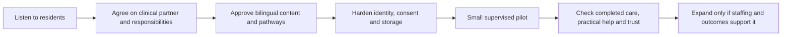

# Why Badaga Care Circle was built

[Home](../README.md) · [Architecture](architecture.md) · [Workflows](workflows.md) · [Roadmap](../ROADMAP.md)

A sudden family loss inspired this project. The goal is to help a community turn concern into practical support: people getting appropriate screening and follow-up, caretakers receiving help, and families sharing essential responsibilities before a crisis.

The first proposed setting is **one consenting Badaga hatti in the Nilgiris**, with a named clinical partner and local coordinators. The current repository is a fictional-data demonstration for discussing that programme. It is not a running clinical service.

## The problem we are trying to address

| Community need | What the demonstration makes concrete | What a real programme needs |
|---|---|---|
| People can seem well while needing screening | General education and a confirmed BP check-in for human review | Qualified screening, an agreed protocol and a receiving clinic |
| Everyone relies on the same caretaker | Specific help requests with acceptance and completion | Willing helpers, realistic capacity and confirmation that help happened |
| Families depend on one person's knowledge | Two trusted backup adults, routine/document locations and rehearsal | Family agreement, privacy and practical handovers |
| Language and unclear advice can obstruct action | Explicit English/Tamil wording and linked source cards | Native-speaker and clinician approval, accessibility sessions |
| Advice can be lost after a conversation | Persistent local review records and task states | Staffed ownership, due dates, referral completion and reliable reminders |

Many people with hypertension have no symptoms. Lifestyle changes and prescribed medicines can both be part of treatment; medication decisions belong with the treating clinician. These are reasons to build a screening and follow-up programme, not to infer an individual's cause of death. [WHO: hypertension](https://www.who.int/news-room/fact-sheets/detail/hypertension).

Observations about tea, sugar, alcohol, social pressure and delayed care should become respectful co-design questions. The software does not label these as traits of every Badaga household, score people for them, or claim that changing one habit prevents sudden death.

## Who it serves

| Person | Useful outcome | Demo experience |
|---|---|---|
| Adult resident | Understand a general care topic and know when to seek human help | English/Tamil guide with sources and fixed warning routes |
| Family member receiving care | Get practical support with consent | Household care tasks and a private backup plan |
| Caretaker | Hand over a specific responsibility and get time or transport help | Requested → accepted → completed tasks |
| Practical helper | See the agreed task information needed to help | Household-scoped task view; health check-ins and backup notes restricted |
| Clinical reviewer | Inspect educational drafts and fictional check-ins | Review queue, required notes and explicit decisions |
| Community coordinator | Discuss a small, accountable programme | Roadmap, workflow demonstrations and aggregate demo counts |
| Engineering contributor | Inspect and reproduce the implementation | Python source, local RAG, tests, eval reports and diagrams |

Role and household selectors are demonstration controls. A real pilot must replace them with verified identities and membership. The demo's clinician role does not establish anyone's qualifications.

## A programme with software in it

The local clinical lead owns medical pathways and source approval. Residents and coordinators shape language, access and useful help. Engineers own reliable workflow implementation, access enforcement and reproducible evaluation. A human review queue needs actual staffing and backup coverage before real enrolment.

## Outcomes that matter

Measure screening completion among eligible enrolled adults, referral completion by agreed due dates, accepted tasks actually completed, and willing households with a rehearsed backup. Include reasons for withdrawal, inaccessible flows, delays, staff workload and privacy incidents. Count completed care rather than messages sent or chatbot sessions.

The proposed 30–50-household, 90-day pilot is a planning assumption, subject to clinical capacity and community agreement. It cannot establish a reduction in cardiac arrest or sudden-death rates. The [roadmap](../ROADMAP.md) defines programme gates and denominators.

## What is available today

The demo includes three fictional households, nine fictional adults, twelve bilingual knowledge cards, eight bilingual navigation tabs, persistent human review, shared tasks, family backup, local evaluations and redacted operational traces. Optional OpenAI drafting needs separate API configuration and explicit external-processing consent.

Clinical content and Tamil medical copy are awaiting review. Badaga-language support, clinical deployment, bookings, private messaging and reminders are future work. The repository contains no real family records, personal story details, credentials or runtime database.
