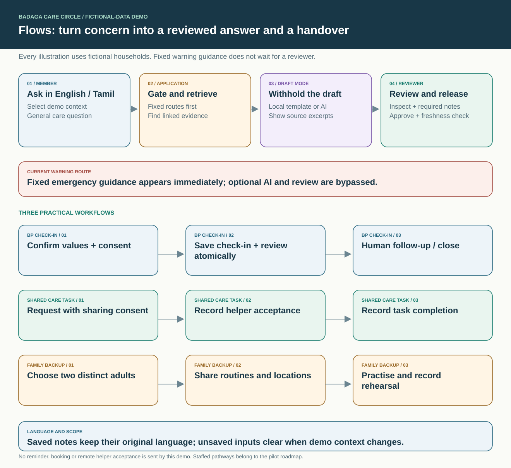
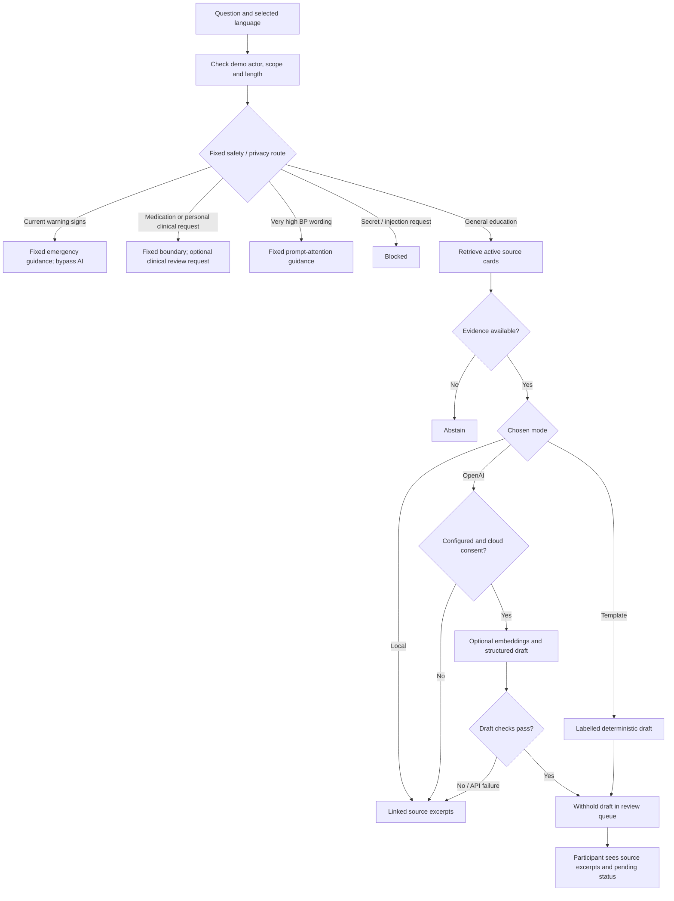
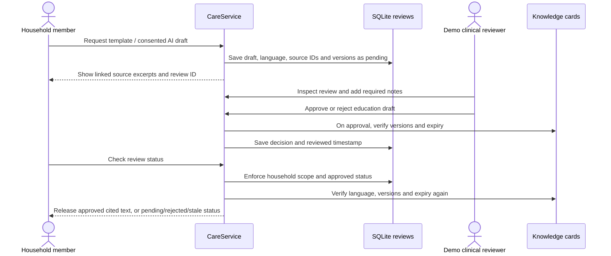
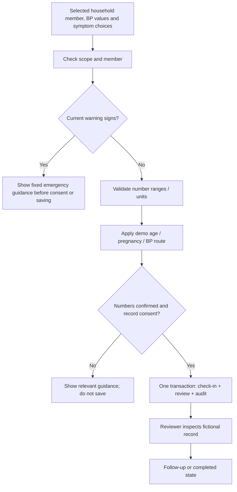
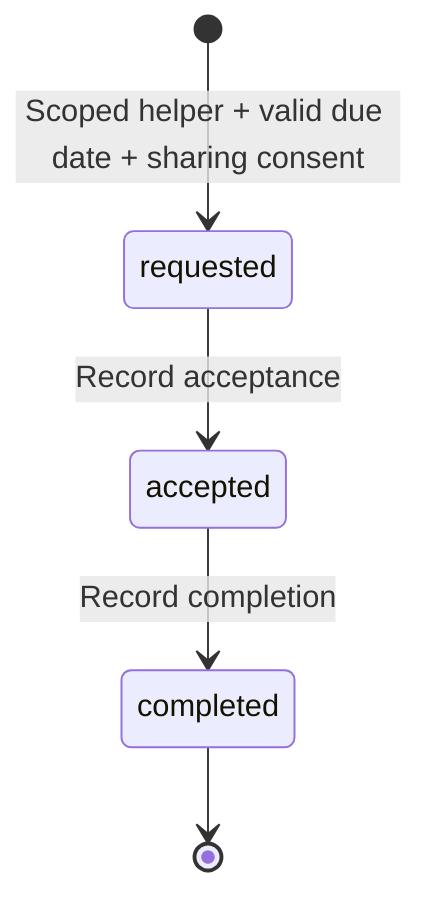
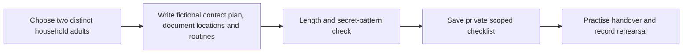

# Illustrated user and system flows

[Home](../README.md) · [Architecture](architecture.md) · [AI and RAG](ai-and-rag.md) · [Evals](evaluations.md)

The examples below use fictional records. Fixed warning guidance appears immediately; a queued reviewer is never an emergency response service.

## General education and optional drafts

The router is a conservative rule-based demo with limited wording coverage. It does not diagnose, prescribe or calculate cardiac-arrest risk. See [the evaluation limits](evaluations.md) and [clinical release gates](../ROADMAP.md).

## Human approval and release

Approving an education draft does not approve the underlying source corpus for clinical deployment. Existing drafts remain in their original language. Changing the interface language does not silently translate a reviewer-approved response.

Clinical review records use `followup` or `close`; education records use `approve` or `reject`. Closing a check-in review marks the linked check-in completed. The demo permits a reviewer to revise decisions and does not implement concurrent-review locking, reviewer assignment or overdue escalation.

## BP check-in

The demo flags systolic ≥180 **or** diastolic ≥120 for prompt attention. This conservative software boundary needs local clinical approval; it is not a diagnosis or a complete triage protocol. Every recorded check-in gets a review, including readings below that boundary. Saving a check-in does not book care or guarantee that a person has reviewed it.

## Share the care

Tasks support transport, bills, elder care and rest/time relief. The helper must be a fictional member of the selected household. The current role controls can record transitions; there is no verified helper identity or remote notification. Skipping directly from requested to completed, reverting a completed task or assigning a helper from another household is rejected.

A real programme must confirm that the helper agreed and the person receiving help benefited. Cancellation, reassignment, reminders and receipt confirmation are future workflow work.

## Family backup

The checklist stores document locations and routines, not passwords, government identifiers or account numbers. Pattern checks catch some unsafe entries, not every sensitive value. Volunteers cannot access the backup plan. The main programme outcome is that two willing adults can carry out the routines, not merely that a form was saved.

## Demo permissions

| Operation | Household member | Volunteer | Clinical reviewer |
|---|---|---|---|
| General education | Selected household | Selected household | Selected household |
| Tasks and transitions | Own selected household | Own selected household | Any selected household |
| Check-ins and private backup | Own selected household | Restricted | Any selected household |
| Review queue / decisions | Own education review status only; no decisions | Restricted | Queue and decisions |
| Traces / operational metrics | Restricted | Restricted | Available |

The backend applies these demo scopes even if a hidden UI control is called directly. The identity itself comes from unverified selectors, so these rules must not be treated as protection for real patient data.

## Language switching

English/Tamil labels, options, fixed messages, source excerpts and roadmap change through explicit translations. Eight permanent navigation labels remain bilingual. Context changes clear unsaved inputs; persisted records remain. Free-text notes and approved drafts keep their original language. Tamil wording still needs fluent-speaker and clinician approval; Tamil support is not Badaga-language support.
